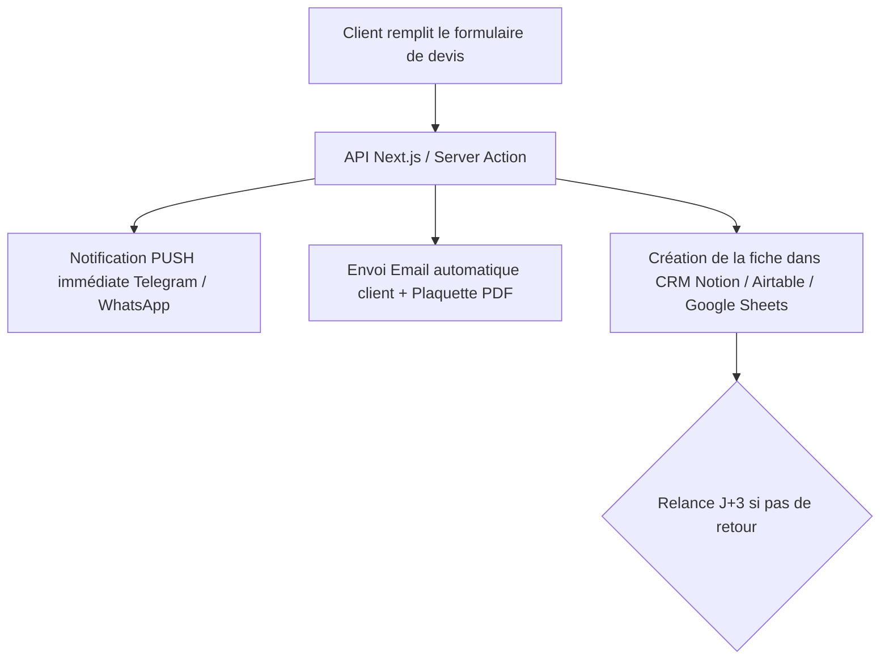

# 🚚 Stratégie de Transformation : La Confrérie
## De l'Emplacement Fixe au Modèle Prestations & Privatisations B2B / Mariages

---

## 🎯 1. Le Constat & L'Opportunité

| Constat Actuel | Opportunité "Prestations Privées" |
| :--- | :--- |
| Emplacement à faible passage piéton / vente aléatoire | **Chiffre d'affaires garanti** à chaque sortie (800 € à 3 500 € par date) |
| Risque d'invendus et gaspillage selon la météo | **Zéro invendu** : nombre exact de convives et menus fixés à l'avance |
| Tickets moyens faibles (12 € – 15 €) | **Paniers moyens élevés** (forfaits 16 € – 25 € / convive + frais de déplacement) |
| **Clients actuels ravis et conquis** | **Validation du produit** : la cuisine plaît, le levier est la distribution |

> **Règle d'or en événementiel :** Le premier traiteur qui répond à une demande gagne le contrat dans **70 % des cas**. L'automatisation de la réponse et la qualification immédiate du prospect sont tes meilleurs atouts concurrentiels.

---

## 🔍 2. Diagnostic Technique du Site (`laconfrerietruck.fr`)

1. **Formulaire de devis non connecté (`app/[locale]/devis/page.tsx`)** :
   - L'envoi est actuellement simulé (`setTimeout(resolve, 2000)`). Les demandes entrantes ne sont ni transmises par email ni enregistrées en base de données.
2. **Page d'accueil 100% orientée "consommateur de passage"** :
   - Choix binaire forcé entre *Malbosc* et *Villeneuve*.
   - Un organisateur d'événement ou un responsable d'entreprise ne voit pas immédiatement qu'il peut privatiser le food truck.
3. **Absence d'estimation budgétaire en temps réel** :
   - Pas de simulateur de budget (nb de personnes, formule, date).
   - Manque de photos grand format du camion en pleine animation (guirlandes, ambiance festive, service fluide).

---

## ⚙️ 3. Les 4 Automatisations Clés à Déployer

### A. Alerte Push Instantanée (Mobile)
- Notification instantanée par **Telegram Bot** ou **WhatsApp** dès qu'un formulaire est validé.
- Données reçues : Nom, Téléphone, Type d'événement, Date, Lieu, Nombre de personnes, Budget estimé.
- Objectif : Rappel téléphonique du client sous 15 à 30 minutes.

### B. Réponse Automatique & Qualification (Emailing)
- Email envoyé instantanément au client (via Resend ou SendGrid).
- Contenu : Confirmation de prise en compte, présentation de l'univers de La Confrérie et lien de téléchargement de la **Plaquette Traiteur / Menus Groupes**.

### C. Simulateur de Devis Interactif sur le Site
- Interface intuitive où le client choisit :
  - Type d'événement (Lendemain de mariage, Afterwork, Séminaire, Anniversaire).
  - Nombre de personnes (barre de défilement : 30 à 200+).
  - Formule choisie (ex. *Street Food Chic*, *Buffet Finger Food*, *Boissons & Desserts maison*).
- Affichage immédiat d'une **fourchette de prix indicative** avant validation du formulaire pour qualifier les prospects et filtrer les demandes hors budget.

### D. Collecte Automatisée d'Avis Google 5 Étoiles
- QR Code plastifié et dynamique posé sur le comptoir du camion : *"Un avis = votre café ou remise fidélité offerte"*.
- Objectif : Dépasser le cap des 50 avis Google 5 étoiles en quelques semaines pour lever tous les freins des organisateurs d'événements.

---

## 🎨 4. Image de Marque & Positionnement "Prestations d'Exception"

### Les Offres Packagées à Présenter

| Formule | Description | Cible Prioritaire |
| :--- | :--- | :--- |
| **Afterwork Corporate** | Wraps gourmands, finger food asiatique, boissons fraîches | Entreprises, agences, startups (Millénaire, Eurêka, Garosud) |
| **Lendemain de Mariage (Brunch)** | Bo-Buns frais, bowls signature, options végétariennes | Mariés cherchant une ambiance décontractée sans vaisselle |
| **Privatisation Fête Privée** | Formule sur-mesure au camion avec ambiance musicale et guirlandes | Anniversaires, départs en retraite, associations |

### Contenu Visuel à Mettre en Scène
- **Le camion comme élément de décor** : photos de nuit avec guirlandes lumineuses, vue d'ensemble du spot.
- **La convivialité en direct** : clients qui sourient en attendant leur bol, dressage minute, fraîcheur des ingrédients.
- **Plaquette commerciale PDF téléchargeable** : document soigné de 3-4 pages destiné aux comités d'entreprise (CSE) et organisateurs de mariages.

---

## 🚀 5. Plan d'Action d'Acquisition Locale (Montpellier & Hérault)

1. **Optimisation Google Business Profile** :
   - Ajouter les catégories secondaires : *Service de traiteur*, *Traiteur pour événements*, *Organisation d'événements*.
2. **Référencement sur les plateformes B2B & Mariages** :
   - Fiche dédiée sur **Mariages.net** (incontournable pour les dimanches de mai à octobre).
   - Inscription sur **Kactus**, **ABC Salles** et **1001Salles** pour capter les demandes d'entreprises.
3. **Prospection B2B Ciblée (Montpellier Tech & Pôles Tertiaires)** :
   - Démarchage des CSE et offices managers sur LinkedIn dans les zones d'activités : *Parc Club du Millénaire*, *Castelnau 2000*, *Espace Eurêka*, *Garosud*.
   - Proposer une offre d'essai ou un format découverte pour leur prochain événement d'équipe.

---

## 📋 6. Prochaines Étapes Immédiates

- [ ] **Étape 1 (Technique)** : Connecter le formulaire de devis à une API d'emailing (Resend) et configurer l'alerte sur smartphone.
- [ ] **Étape 2 (UX / Design)** : Ajouter un bouton bien visible *"Privatiser le Food Truck / Événements"* sur la page d'accueil de `laconfrerietruck.fr`.
- [ ] **Étape 3 (Commercial)** : Rédiger la grille tarifaire standard (prix par personne, minimum de facturation, frais kilométriques).
